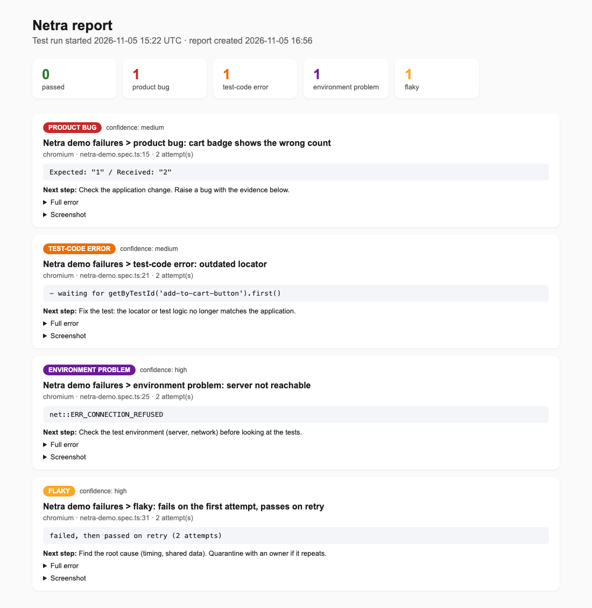
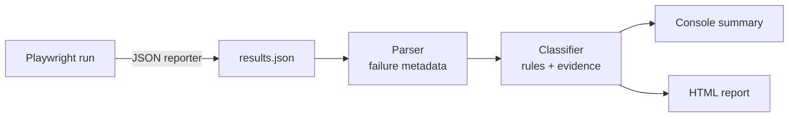

# Netra

**Netra** (Sanskrit नेत्र, "eye") keeps an eye on Playwright test runs and tells the team what really failed, and why.

A red test run usually needs someone to open the CI logs and work out, test by test, whether the problem is a real bug, a broken test, an unavailable environment or just a flaky test. Netra reads the Playwright JSON report, classifies every failure, shows the evidence for each verdict, and writes a report that says what to do next.



## How it works



Each part has one responsibility:

| Module | Responsibility |
|---|---|
| `netra/parser.py` | Reads the Playwright JSON report, walks the nested suites and extracts failure metadata: test, browser project, status, attempts, error message, location, cleaned error text, screenshots and traces. |
| `netra/classifier.py` | Decides what kind of failure it is and returns a verdict with a confidence level and the evidence it was based on. |
| `netra/report.py` | Writes a single, self-contained HTML report: summary, failures ordered by importance, evidence and a concrete next step for each. |
| `main.py` | Runs the pipeline: parse, classify, print, write the report. |

## Classification

Rules are checked in a fixed order, from the most certain signal to the least certain:

| Order | Verdict | Signal | Confidence |
|---|---|---|---|
| 1 | Flaky | Playwright marks the test as flaky: it failed, then passed on retry | high |
| 2 | Environment problem | Network errors such as `net::ERR_*`, `ECONNREFUSED`, HTTP 502/503/504: the application was not reachable | high |
| 3 | Test-code error | Strict-mode violation, or a TypeError / ReferenceError / SyntaxError in the test | high |
| 3 | Test-code error | An action timed out waiting for an element that never appeared, while the page itself loaded: usually an outdated locator | medium |
| 4 | Product bug | The element was found, but shows a different value than expected (Expected / Received) | medium |
| 5 | Needs investigation | No rule matched | low |

Two principles:

- **Every verdict carries its evidence**, the exact part of the error that led to it, so a person can always check the reasoning.
- **No guessing.** If no rule matches, the verdict is "needs investigation" rather than a forced category.

## Design choices

- **No third-party APIs or services.** Netra uses only the Python standard library. Test results and logs never leave the machine, which matters for teams with sensitive data.
- **Deterministic first.** Rules are fast, cheap and repeatable. They handle the clear cases; anything uncertain is flagged instead of guessed.
- **Tested.** The classifier has its own unit tests, written with the built-in `unittest` module.

## Running it

Requirements: Python 3.10 or newer, and a Playwright suite configured with the JSON reporter:

```ts
// playwright.config.ts
reporter: [['html', { open: 'never' }], ['list'], ['json', { outputFile: 'reports/results.json' }]],
```

Run Netra on a report:

```bash
python3 main.py path/to/results.json
open reports/netra-report.html
```

Run the unit tests:

```bash
python3 -m unittest discover -s tests -t . -v
```

### Demo

The demo uses my own Playwright suite for a demo web shop, which contains a spec with four deliberate failures, one of each type. They only run when `NETRA_DEMO=1` is set:

```bash
# in the Playwright project
NETRA_DEMO=1 npx playwright test tests/netra-demo.spec.ts --project=chromium --retries=1

# in Netra
python3 main.py ../ajTests/reports/results.json
```

Result: all four failures are classified correctly (product bug, test-code error, environment problem, flaky).

## Project structure

```
Netra/
├── netra/
│   ├── parser.py        # Playwright JSON → failure metadata
│   ├── classifier.py    # failure → verdict with evidence
│   └── report.py        # verdicts → HTML report
├── tests/
│   └── test_classifier.py
├── docs/
│   └── report-screenshot.png
└── main.py
```

## Roadmap

1. **History:** store every run in a local SQLite database to separate new failures from recurring ones and to measure how often a test is flaky over time.
2. **Grouping:** cluster failures with the same root cause, so one broken service doesn't appear as twenty separate problems.
3. **AI-assisted analysis (local only):** for failures the rules can't decide, an agent running on a local model explains the likely cause and suggests a fix. Its explanation must cite evidence that really appears in the logs, and it answers "needs investigation" when it isn't confident.
4. **Evaluation:** a labelled set of real and injected failures to measure classification accuracy per category, for the rules and for the agent.
5. **Nightly runs:** run the suite and Netra on a schedule in CI.

## About

Netra is an independent personal project, built from scratch by Mariya Damavarapu. It is not affiliated with any current or former employer and contains no employer code.

## License

MIT, see [LICENSE](LICENSE).
